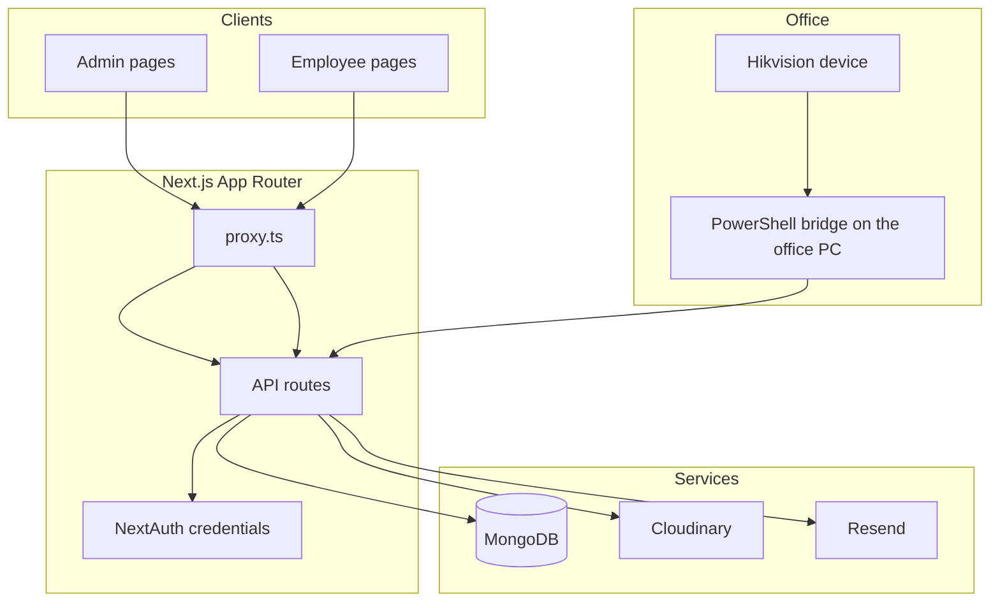
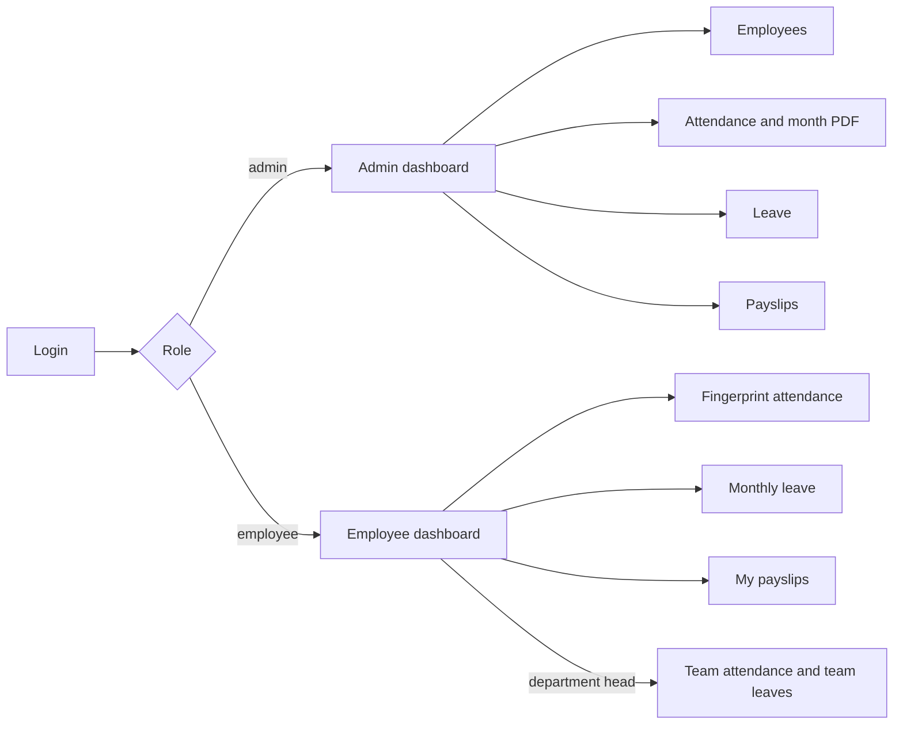

# HR Management System

Production HR portal for Sync Up. Admins manage people, attendance, leave, and payslips. Employees see their fingerprint punches, request monthly leave, and download their own payslips. Access is split by role.

## What it does

| Area | Behavior |
|------|----------|
| People | Employee directory. Inactive and Terminated employees stay out of the daily sheet. |
| Attendance | Fingerprint punches from the office Hikvision device. Earliest punch of the Karachi day is check-in. A later punch becomes check-out only when it is at least 15 minutes after check-in. |
| Leave | Each month: 2 full days and 1 half day (20 hours). Unused leave does not move to the next month. Employees apply at least 2 days ahead. Sunday is not a leave day. |
| Urgent and extra paid leave | Set by Admin. These are not self-serve. |
| Payslips | Generated from the same payable hours as the month attendance PDF: extra hours cover short days first, then the remaining monthly leave hours. |
| Birthdays and reviews | Two daily Vercel crons email birthdays and mark internship or probation reviews due. |
| Access | NextAuth JWT. Pages are split into `/admin` and `/employee`. |

Department heads approve leave for their own department. A department head's own leave, and any other head's leave, is decided by Admin. Heads can view team attendance. They cannot change check-in or check-out.

## System overview





## Attendance

- Timezone is Asia/Karachi.
- The device cannot call Vercel. `scripts/hikvision-bridge.ps1` runs on the office PC, reads fingerprint events, and posts them to `/api/hikvision/events`.
- Only fingerprint success events become punches. Face, card, and door events do not.
- Admin can set or correct a day's times.
- The month PDF shows attended, extra, paid, short, and payable hours. Extra minutes fill short days first. What remains can be covered by the unused part of the 20-hour monthly leave. Approved full, half, and urgent leave already use part of those 20 hours. Extra paid leave and holidays do not.
- A worked day on approved full leave counts the actual hours. A leave day with no completed punch stays paid leave.

## Leave

- Employee requests are Full day (1 or 2 working days) or Half day (one working day).
- The start date must be at least two Karachi days ahead, and it cannot be a Sunday.
- Pending and approved requests count against that month. Rejected requests do not.
- A department head still approves teammates. Head leave is not approved by a head.
- Older annual, sick, or casual rows can still appear in history under those names. New requests cannot use those types.

## Tech stack

| Layer | Choice |
|-------|--------|
| App | Next.js 16 App Router, React 19, TypeScript |
| Data | MongoDB and Mongoose |
| Auth | NextAuth v4, credentials, JWT |
| UI | Tailwind CSS v4 |
| Reads | SWR |
| Writes | `fetch` |
| PDF | jsPDF in the browser |
| Photos | Cloudinary |
| Email | Resend |
| Host | Vercel |

There is one app. Pages and API routes deploy together. Redux, Axios, and React Query are not used.

## Project structure

```
app/
  (admin)/admin/           Admin pages
  (employee)/employee/     Employee pages, including department pages for heads
  api/admin|employee|head  HTTP handlers
  api/hikvision            Fingerprint listener
  api/cron                 Birthdays and review checks
  components/              UI
lib/                       Attendance, leave, auth, email
modals/                    Mongoose models
scripts/                   Office fingerprint bridge
proxy.ts                   Sends each role to its own pages
vercel.json                Cron schedules
```

## Setup

```bash
npm install
cp .env.example .env
npm run dev
```

Open `http://localhost:3000`.

| Variable | Purpose |
|----------|---------|
| `MONGODB_URI` | MongoDB connection string |
| `NEXTAUTH_SECRET` | JWT signing secret |
| `NEXTAUTH_URL` | `http://localhost:3000` locally, the live URL in production |
| `CRON_SECRET` | Required bearer token for cron routes |
| `RESEND_API_KEY` and `RESEND_FROM_EMAIL` | Mail |
| `CLOUDINARY_URL` or the three Cloudinary keys | Profile photos |
| `HIKVISION_LISTENER_SECRET` | Secret in the fingerprint listener path |

The first admin is a user document with role `admin`. This repo does not ship a seed command.

## Scripts

| Command | What it does |
|---------|----------------|
| `npm run dev` | Local server |
| `npm run build` | Production build |
| `npm start` | Serve the production build |
| `npm run lint` | ESLint |

## Deploy

1. Push to GitHub and import the project in Vercel.
2. Set the environment variables above. `NEXTAUTH_URL` must be the live origin.
3. Allow the Vercel network on MongoDB Atlas.
4. Crons in `vercel.json` run at 19:00 UTC, which is 00:00 in Karachi:
   - `/api/cron/birthdays`
   - `/api/cron/check-reviews`

Both cron routes reject calls that do not send `Authorization: Bearer <CRON_SECRET>`.

The office PC keeps its own copy of `scripts/hikvision-bridge.ps1`. A git push updates the HR app. It does not update the script already sitting on that PC.

## Security

- Do not commit `.env` or `scripts/hikvision-bridge.config.ps1`.
- Cron routes stay locked unless `CRON_SECRET` matches.
- The fingerprint listener stays locked unless the path secret matches `HIKVISION_LISTENER_SECRET`.
- An employee can open only their own payslips, leave, and attendance. An admin cannot open `/employee` pages, and an employee cannot open `/admin` pages.

## Smoke check

- Admin login and employee login
- New employee welcome email
- Password reset link uses the production `NEXTAUTH_URL`
- A fingerprint punch shows on the employee attendance page
- A full-day or half-day leave request, then approval
- A head's own leave is not decided by that head
- Month attendance PDF and payslip hours agree
- Cron routes return 401 without the secret

## License

Private. All rights reserved unless the repository owner says otherwise.
